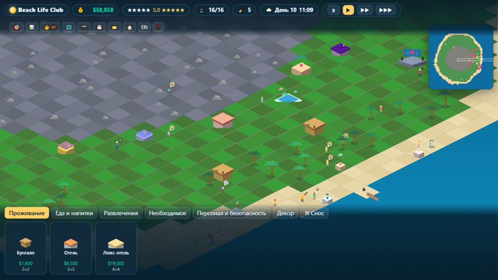

# Beach Life Club 🏝️

Браузерный курортный симулятор — оригинальное переосмысление классической игры
**Beach Life / Spring Break (2002)**. Та же идея: превратить дикий тропический
остров в процветающий курорт. Полностью новый код, процедурная графика и
собственный баланс — **ни одного файла, ассета или строки кода из оригинальной
игры не используется**.



## Запуск

Никаких зависимостей и сборки — только статические файлы.

```bash
# любой статический сервер, например:
python -m http.server 8080
# или
npx serve -l 8080 .
```

Откройте `http://localhost:8080`. Начните с «Первой звезды» или с песочницы.

## Геймплей

- **Стройте** 28 объектов: бунгало, отели и люкс-отели, бары, кафе и ресторан,
  бассейн, джакузи, волейбол, прокат сёрфов и водных велосипедов, сцену и
  дискотеку, туалеты, души, магазин, вышку спасателя, медпункт, базы персонала,
  декор.
- **Гости** приезжают на пароме: у каждого 6 потребностей (отдых, голод, жажда,
  туалет, гигиена, развлечения), кошелёк, характер и свой отпечаток на карте.
  5 архетипов: тусовщик, солнцепоклонник, спортсмен, семья, тихоня.
- **Персонал**: уборщики, механики, спасатели, охрана, аниматоры — каждый
  требует базовое здание и зарплату.
- **Живой остров**: день/ночь, погода (солнце/облака/дождь/шторм), акулы и
  медузы, износ построек, мусор, пьяные дебоши.
- **Экономика**: доходы с номеров и услуг, обслуживание, зарплаты; банкротство
  возможно.
- **Рейтинг** 1–5 звёзд из отзывов уезжающих гостей определяет приток новых.
- **3 сценария** с целями и дедлайнами + бесконечная песочница.
- Сохранение/автосохранение (localStorage), фото на память (PNG),
  мини-карта, RU/EN интерфейс.

## Управление

| Действие | Ввод |
|---|---|
| Выбрать здание/гостя | ЛКМ |
| Строить | карточка в нижней панели → ЛКМ по карте |
| Отмена инструмента | ПКМ / Esc |
| Камера | WASD / стрелки / тащить ЛКМ |
| Зум | колесо мыши |
| Пауза / скорости | Space / 1 / 2 / 3 |

## Структура проекта

```
index.html          — точка входа, разметка HUD/панелей
src/
  style.css         — весь UI
  main.js           — загрузка, ввод, связывание всего
  core/             — rng (mulberry32+fbm), шина событий, i18n (RU/EN),
                      игровой цикл с фиксированным шагом, save/load
  world/            — генератор острова (heightmap→тайлы), A*-поиск пути,
                      изометрическая камера
  game/             — чистая симуляция без DOM: каталог, здания/износ,
                      гости (нужды, ИИ выбора заведения), персонал,
                      экономика, погода/опасности, рейтинг, сценарии,
                      центральное состояние + сериализация
  render/           — процедурные спрайты зданий/юнитов (canvas 2D),
                      рендер сцены (вода, день/ночь, погода), DOM-UI
tools/smoke.mjs     — headless-тест симуляции: node tools/smoke.mjs
```

Симуляция (`src/game/`) не знает про DOM — её можно гонять в Node
(`npm test`) или обвешивать любым другим рендером.

## Тесты

```bash
node tools/smoke.mjs
```

Проверяет генерацию карты, поиск пути, стройку/снос, наём, 6 игровых дней
тиков, save/load roundtrip и сценарную логику.

## Правовая заметка

Это фанатская homage-игра, написанная с нуля. «Beach Life» — торговая марка
своих правообладателей; проект не содержит и не использует материалы
оригинальной игры. Механики жанра не являются объектом авторского права,
все выражения (код, графика, тексты, баланс) здесь оригинальные.
